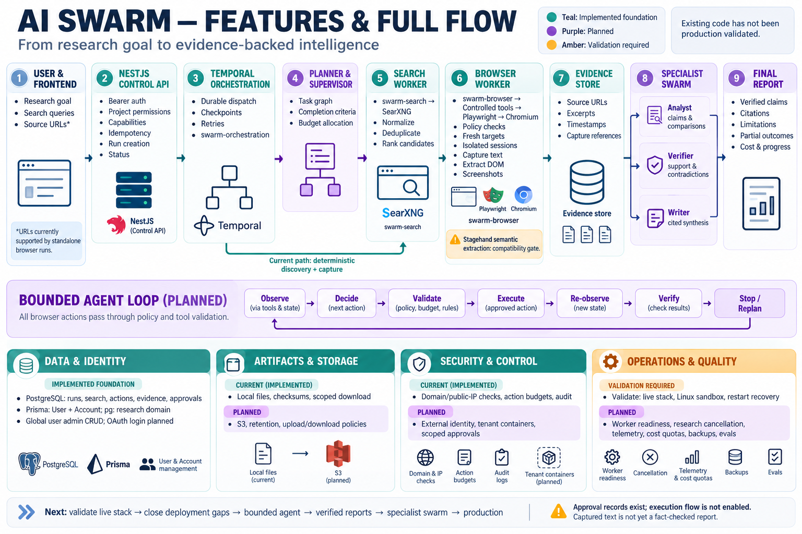

# AI Swarm: documentation review and overall implementation plan

Reviewed: 22 October 2026. This guide synthesizes all six documents in this folder and checks their major implementation claims against the repository. It is a development roadmap, not a claim of production readiness. No live infrastructure or test suite was executed for this documentation review.



See the [phase-wise code audit and feature checklist](PHASE_WISE_CHECKLIST.md) for source-backed completed items, pending work and unverified acceptance gates.

See the [PostgreSQL, Prisma and schema implementation plan](POSTGRES_PRISMA_SCHEMA_PLAN.md) for model specifications, migration onboarding, repository conversion and database delivery phases.

For implemented database wiring and safe onboarding, see [database setup](DATABASE_SETUP.md).

## Product objective

Build an AI research swarm that turns a user goal into a bounded plan, discovers relevant sources, captures evidence through controlled browser tools, delegates focused reasoning tasks, checks claims, and produces a cited report. Users should be able to inspect progress, costs, failures, evidence and approval requests, and cancel work reliably.

“Ultimate” means reliable, evidence-backed and extensible. The first useful product is public-web research; autonomous publishing, purchases and broad authenticated automation follow only after separate capability and approval gates.

## Review of every existing document

| Document | What it contributes | Findings and how to use it |
| --- | --- | --- |
| [Browser backend plan](BROWSER_BACKEND_PLAN.md) | Browser tool boundary, SDK ownership, target freshness, agent loop, provenance, approvals and isolation | Strong browser design. Its opening starter-only status and proposed `src/modules` tree are historical. Actual code uses `src/browser` and `src/search`. Stagehand shared-session compatibility remains a gate; SDK installation does not prove semantic execution works. Use its contracts and security requirements, not its initial implementation order, to guide remaining work. |
| [Worker architecture plan](WORKER_ARCHITECTURE_PLAN.md) | Separate API/search/browser/orchestration processes, Temporal queue ownership, search normalization and recovery | Preserve this process model and deterministic workflow boundary. Its planning-only status is outdated: worker entrypoints and workflows exist. Separate ResearchRun/SearchRun/BrowserRun entities are proposals; current persistence uses a unified `runs` table. Reconcile proposed budgets with actual configuration before treating them as defaults. |
| [Service implementation plan](SERVICE_IMPLEMENTATION_PLAN.md) | Dependency-ordered delivery across configuration, security, persistence, tools, workers and deployment | Best detailed implementation checklist for the existing layout. Opening status reflects implemented foundations, but sections such as “Prisma is not installed” and “First implementation batch” are stale. Resume from failed or unverified acceptance gates instead of rebuilding foundations or registering scaffold providers. |
| [Implementation status](IMPLEMENTATION_STATUS.md) | Delivered features, historical local checks, blockers and remaining gates | Useful record of deterministic search/capture capability. It predates the user/account Prisma work and does not establish current live-stack readiness. Host-specific Docker, Chromium and lint failures are historical observations requiring fresh verification on the release host. |
| [Prisma implementation plan](PRISMA_IMPLEMENTATION_PLAN.md) | Schema parity, populated-database baselining, repository conversion, concurrency and migration ownership | Full run-domain conversion is still a proposal, but “no Prisma packages or code” is obsolete. Prisma currently models User and Account; run/search/browser persistence still uses `pg`. Preserve existing tables and constraints. Do not replace the unified run model or claim migration cutover has happened. Version guidance in this historical plan needs verification when adoption work begins. |
| [User API](USER_API.md) | Implemented administrative CRUD, password handling, OAuth account records, Prisma setup and live-test command | Most specific reference for current user management. The `users` capability grants global administration; project membership and end-user login are not implemented by these routes. OAuth account storage does not establish an OAuth login flow. Compose currently runs only legacy research migrations, so user/account migrations require a separate deployment step. |

When documents disagree, use current source and migrations to establish implemented behavior. Use this roadmap for cross-cutting priorities, the service plan for component checklists, and the older architecture plans for design constraints. Historical verification claims must be reproduced before release.

## Current baseline and gaps

| Area | Present in the repository | Work still required |
| --- | --- | --- |
| API and access | NestJS APIs, configured bearer principals, project/capability checks and creation idempotency | Identity provider, membership lifecycle, quotas and operational audit integration |
| Search | Bounded SearXNG client, normalization, candidate selection and persisted query recovery | Live provider validation, source-quality evaluation and richer planning |
| Durable execution | Temporal workflows, dispatch reconciliation and three worker entrypoints | Live restart/cancellation tests, workflow evolution policy and worker readiness |
| Browser | Playwright lifecycle, controlled tools, domain/public-IP proxy policies and capture | Linux sandbox/egress verification, Stagehand compatibility and semantic extraction |
| Research | Goal storage and search-to-browser workflow | Goal-driven planning, bounded LLM reasoning, specialist delegation and synthesis |
| Persistence | SQL run/search/action/evidence/artifact/approval tables; Prisma User/Account models | Run-domain Prisma parity and cutover, identity ownership and feature migrations |
| Artifacts | Local storage and authorized retrieval | S3 implementation, retention, controlled file transfer and coordinated cleanup |
| Approvals | Database records and denial of sensitive submissions | Action-bound approval execution, expiry, authorization and safe resume |
| Quality | Fixture, API and persistence tests; recorded prior checks | Reproduced release checks, real PostgreSQL/Temporal/Compose tests and report-quality evals |

The current research endpoint requires `goal` and `search`. The goal does not yet control an LLM loop. It performs discovery followed by deterministic capture. There is no research cancellation route in the current controller. SSE progress, report endpoints, approval resolution and supplied-URL research inputs remain proposals unless separately implemented. Standalone browser runs accept URLs today.

## Target architecture

```text
User / frontend
  -> NestJS control API
       identity, project permissions, idempotency, quotas, status, cancellation
  -> Persisted run + durable Temporal dispatch
  -> Research workflow (swarm-orchestration)
       -> Planner: bounded task graph and completion criteria [proposed]
       -> Search activities (swarm-search) -> SearXNG
       -> Ranked candidate sources
       -> Browser activities (swarm-browser)
            bounded agent -> controlled tools -> session manager -> Chromium
            Playwright; Stagehand only after compatibility approval
       -> Evidence records + artifact storage
       -> Analyst / verifier / writer activities [proposed]
       -> Cited report + unresolved claims + completion summary [proposed]

PostgreSQL: ownership, runs, dispatch, checkpoints, evidence, usage, approvals
Object storage: captures and report artifacts, with authorized metadata access
Telemetry: correlated run/activity/model/tool events and resource usage
```

Keep the single repository and separate process entrypoints. Workflows contain deterministic scheduling; HTTP, database, model and browser effects execute in activities. Introduce an additional reasoning queue only when independent scaling or isolation justifies it. Avoid another queue system alongside Temporal.

### Specialist roles

These are proposed application roles, not existing autonomous agents. Begin with structured stages; enable bounded parallel tasks once their individual quality gates pass.

| Role | Input and output | Limits |
| --- | --- | --- |
| Planner | Goal -> subtasks, source needs, completion criteria and allocated budgets | Fixed task/depth limits; no recursive spawning without a hard cap |
| Search specialist | Approved queries -> ranked, deduplicated candidates with provenance | Search snippets are discovery metadata |
| Browser researcher | Candidate URLs -> source excerpts, structured fields and capture references | All operations pass through the existing tool/policy layer |
| Analyst | Captured evidence -> candidate claims, comparisons and contradictions | Evidence references required; no invented missing facts |
| Verifier | Claims plus evidence -> supported, contradicted or insufficient-evidence decisions | Independent check; model agreement alone is not verification |
| Writer | Verified claims -> readable report, citations and limitations | Unsupported claims excluded or explicitly marked unresolved |
| Supervisor | Stage outcomes -> bounded retry, replan, partial completion or stop | Enforces total cost/time/action limits; cannot grant capabilities |

### Contracts and data ownership

Retain the existing run model during foundation work. Add feature records only when their behavior is implemented:

- `Task` and `TaskDependency`: parent run, role, explicit inputs/outputs, status, attempt and deterministic task identity. Validate an acyclic, bounded graph.
- `AgentStep` and `ModelCall`: sequence, model/provider, prompt/schema versions, tool decisions, usage, duration and sanitized outcome.
- `SearchCandidate`: stable source selection, score, rationale and source-result linkage when current JSON storage becomes insufficient.
- `Claim` and `ClaimEvidence`: versioned claim text, support status, evidence IDs, excerpts and contradictions.
- `ResearchReport`: report version, claim references, citations, limitations and artifact references.
- Expanded `Approval`: exact action/payload hash, policy version, requester/decider, expiry and one-time consumption.

Every task and record inherits trusted ownership from the run. Models cannot choose tenant/project identity or increase permissions. Shared agent context should contain scoped evidence references and structured outputs. Persisted browser credentials and cross-run vector memory are later features requiring retention and isolation design.

## Implementation roadmap

Milestones are dependency gates, not calendar promises. Estimate effort after the live-stack audit and model-quality baseline.

| Phase | Concrete deliverables | Exit gate |
| --- | --- | --- |
| 0. Reproduce the baseline | Inventory active versus scaffold services; run build/tests; start PostgreSQL, SearXNG, Temporal, API and workers; record environment and results | Real search, browser and research runs succeed; worker restart, duplicate delivery and cross-project denial are demonstrated; unresolved failures are recorded |
| 1. Close execution and deployment gaps | Research cancellation; worker readiness; cleanup ownership; Linux browser isolation checks; explicit deployment of both current migration sets | Cancelled work releases resources, late writes cannot regress terminal state, fresh deployment supports both research and users, and populated-database onboarding preserves data |
| 2. Consolidate persistence | Follow Prisma parity/baseline/provider/repository/image milestones; preserve API and SQL semantics | Fresh and populated PostgreSQL paths, drift rejection, concurrent idempotency and scoped reads pass; one migration owner after cutover |
| 3. Deliver one bounded research agent | Structured model client, usage accounting, bounded decisions, schema extraction, evidence links and stop conditions | Representative public-source tasks produce validated evidence within budgets; malicious page instructions, malformed model output and loops fail safely |
| 4. Deliver verified reports | Claim ledger, independent verification, contradictions, report synthesis and citation rendering | Every asserted factual report claim has an accessible supporting excerpt; unsupported/contradicted claims are handled explicitly; failed sources remain visible |
| 5. Add specialist swarm execution | Bounded task graph, role contracts, controlled parallelism, checkpoint recovery and supervisor decisions | Better task quality or latency than the single-agent baseline at an agreed cost; retries do not duplicate logical results and one failed specialist permits honest partial output |
| 6. Add product controls | Project-scoped progress events, report retrieval, cost display, approval resolution and safe resume | Reconnection recovers progress, unauthorized subscriptions fail, stale/replayed approvals fail, and waiting releases browser resources |
| 7. Qualify production | S3/retention, external identity, tenant isolation, immutable images, secret management, telemetry, backups and load/failure testing | Restore drill, isolation tests, capacity limits, alerting and staged rollback meet recorded release targets |

Phases 0–1 come first. Prisma work can proceed independently of the model adapter if interfaces remain stable, but avoid changing persistence and reasoning behavior in the same rollout. A bounded Playwright-only agent is an acceptable Phase 3 path if documented; Stagehand semantic use requires its own passing compatibility matrix. Public research does not depend on enabling consequential actions.

### Phase 3 execution loop

1. Load the authorized run, policy snapshot and remaining budgets.
2. Translate the goal into bounded completion criteria and queries.
3. Discover sources or use supplied URLs once that research contract is implemented.
4. Observe a selected page and request a schema-validated model decision.
5. Validate capability, destination, target freshness and budget through the tool layer.
6. Execute, observe the resulting state and persist evidence/checkpoint data.
7. Stop on completion, cancellation, budget exhaustion, repeated no-progress or unrecoverable failure.
8. Produce explicit per-source outcomes and close sessions in every exit path.

Persist recoverable logical state, not browser handles. After a restart, recreate the session and re-observe; never reuse old target references. Model-provider retries and Temporal retries share a total attempt/cost budget so nested retries cannot multiply work without bound.

### First implementation backlog

1. Record fresh build, fixture, HTTP and live-stack results in `IMPLEMENTATION_STATUS.md` with host/runtime details.
2. Add the missing project-scoped research cancel endpoint and prove propagation through discovery and capture, including terminal-state races.
3. Add an explicit user/account migration deployment step and fresh/populated database runbook before advertising complete Compose setup.
4. Prove worker readiness and cleanup under interruption; validate browser sandbox and network restrictions on the deployment host.
5. Complete the Stagehand compatibility experiment or record the Playwright-only decision.
6. Define the model-decision, evidence, claim and report schemas; implement one model adapter and run-level usage limits.
7. Deliver one evidence-producing agent before adding specialist coordination.
8. Add report verification and a repeatable evaluation dataset; use the baseline to decide whether multi-agent work improves results.

## Reliability and policy requirements

- Enforce run-level wall time, tokens/cost, source count, concurrent tasks, browser actions/tabs and recovery attempts. Reserve budget before parallel model calls; reconcile actual usage afterward.
- Keep database writes retry-safe using scoped uniqueness and guarded transitions. Durable workflow dispatch needs reconciliation across database and Temporal failures.
- Treat public research reads separately from external mutations. A crash after a submission can leave an uncertain outcome; do not retry blindly.
- Treat web pages and retrieved text as untrusted content. They cannot override instructions, read secrets, grant tools or authorize another project.
- Enforce destination policy for redirects, popups and subrequests, backed by production egress isolation. Browser contexts alone do not establish tenant security.
- Bind future approvals to exact actions and payloads; revalidate permissions and destination on resume. Human approval does not make stale browser references valid.
- Keep source URLs, retrieval times, excerpts and capture references. Source agreement and citation presence do not by themselves establish truth or independent corroboration.

## Evaluation and release evidence

Build a versioned fixture/evaluation set covering simple extraction, multi-source comparison, conflicting facts, unavailable pages, dynamic content, malicious instructions and cancellation. Keep deterministic tool tests separate from live-provider and model evaluations.

| Measure | What to record |
| --- | --- |
| Goal completion | Fully completed, partial, no-results, failed and cancelled outcomes |
| Evidence quality | Claim support, excerpt accuracy, contradiction handling and unsupported assertions |
| Citation quality | Valid evidence references, correct excerpt linkage and source accessibility |
| Efficiency | End-to-end p50/p95 latency, queue delay, tokens, cost and duplicate work |
| Recovery | Worker restart, replay, provider outage, dispatch reconciliation and cancellation latency |
| Isolation | Cross-project denial, blocked egress, prompt-injection outcomes and secret redaction |
| Operations | Active/leaked browser processes, memory, storage growth and cleanup latency |

Set numerical quality, cost and latency targets after a measured baseline and before release. Compare single-agent and swarm variants on the same tasks and budgets. Required policy invariants include zero successful unauthorized cross-project access in the suite and evidence links for every asserted factual report claim.

## Running and validating the current project

See the [root README](../README.md) for environment variables, current API routes and process commands, and [User API](USER_API.md) for administrative permissions and PostgreSQL test setup. Preserve existing `.env` credentials. Host processes use localhost service addresses; containers use service hostnames.

```sh
npm ci
npm run build
npx tsc --noEmit --incremental false
npm test -- --runInBand
npm run test:e2e -- --runInBand
npx oxlint src/ test/ tests/ scripts/
npm run browser:compatibility
```

These are validation commands, not results from this review. Browser checks require the appropriate Chromium installation; semantic compatibility additionally requires supported full Chromium/extension and model configuration. The user API live suite skips without `USER_API_TEST_DATABASE_URL`; a skipped suite does not verify PostgreSQL behavior.

On a Docker-enabled host with configured environment values:

```sh
docker compose --profile engine config --quiet
docker compose --profile engine build
docker compose --profile engine up -d
```

Database update: Compose now uses a dedicated Prisma migration target for identity and run-domain tables. Existing populated databases require reviewed baseline onboarding in [database setup](DATABASE_SETUP.md). Research execution still uses pg repositories. Do not reset an existing database or assume that client generation creates tables.

The existing Temporal development server and floating infrastructure image defaults are local development choices. Production deployment is Phase 7 work.
